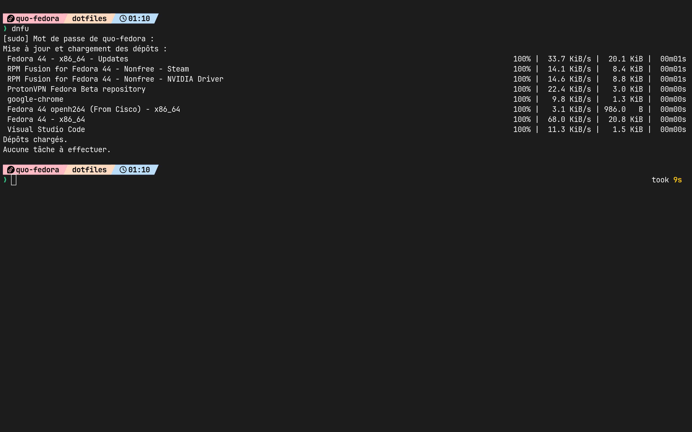

# 🪐 Dotfiles Fedora — Minimal & Pastel (KISS)

[](https://fedoraproject.org/)
[](https://www.zsh.org/)
[](https://starship.rs/)
[](LICENSE)

Configuration épurée, performante et maintenable pour environnement Linux axée sur le principe KISS (*Keep It Simple, Stupid*).

---

## 📸 Aperçu



---

## 📁 Structure du dépôt

```text
dotfiles/
├── starship/
│   └── starship.toml    # Configuration du prompt (capsule bicolore & timer)
├── preview.png          # Capture de démonstration du terminal
├── LICENSE              # Licence libre MIT
└── README.md            # Spécifications et guide de déploiement
